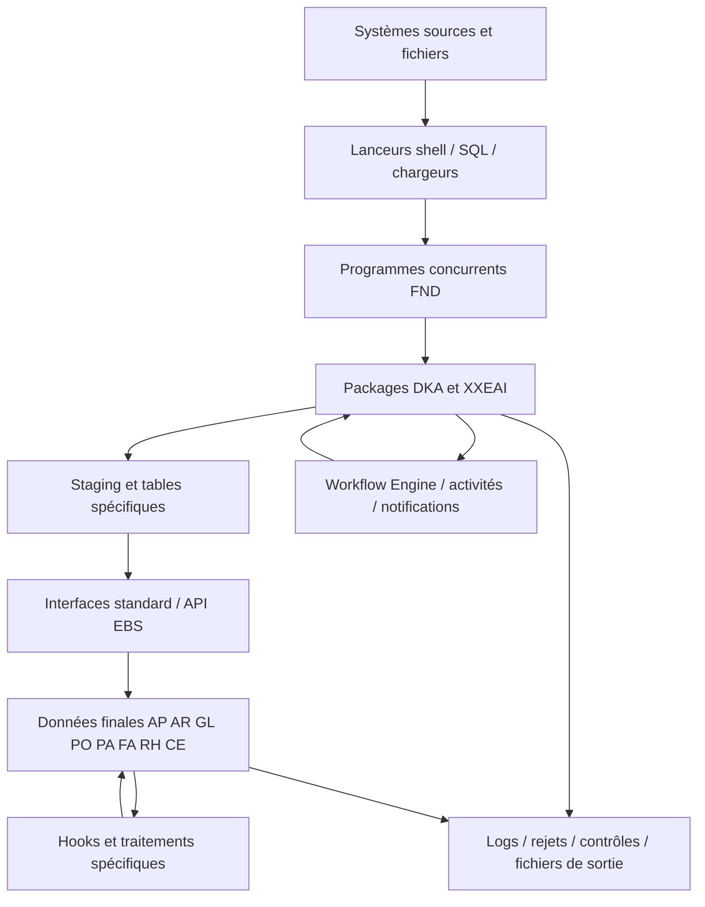

# Synthèse et architecture DKA

## Conclusion

Le dossier DKA contient les sources et exports de déploiement d’une application spécifique Oracle E-Business Suite. Son périmètre dépasse la facturation : intégrations, achats, référentiels, comptabilité, projets, immobilisations, employés, banques, règlements, workflows, clôtures, reprises et administration.

La chaîne technique peut réunir un shell, un SQL de lancement, une définition de programme concurrent, un exécutable, un package et des objets de données. Les workflows ajoutent une orchestration par événements, activités, résultats et notifications. Les hooks introduisent des traitements indirects qui ne figurent pas nécessairement comme jobs autonomes.

Le catalogue recense les fichiers ; les programmes FND sont reliés aux valeurs d’exécutables exportées ; les fiches signalent les références et frontières transactionnelles candidates. Les notes spécialisées précisent les chaînes réellement établies dans le code. Cette cartographie locale ne prouve pas la composition de l’environnement installé.

## Organisation des sources

| Emplacement | Rôle observable |
|---|---|
| `dka/12.0.0/bin` | Lanceurs shell, fichiers de contrôle de chargement et variantes d’exploitation |
| `dka/12.0.0/sql` | SQL de lancement, extractions et certains packages spécifiques |
| `dka/12.0.0/admin/sql` | Corps et spécifications PL/SQL, tables, vues, index, triggers, séquences et scripts |
| `dka/12.0.0/admin/import` | Définitions FNDLOAD, programmes, paramètres, messages, valeurs, workflows et autres configurations |
| `dka/12.0.0/admin/driver` et `admin` | Éléments de livraison et déploiement |

Un suffixe ou un nom de répertoire est un indice de rôle. Les fiches et notes doivent être consultées pour établir le comportement d’un composant particulier.

## Architecture de lecture

Le schéma représente des couches possibles ; chaque flèche ne signifie pas que tous les composants de ces couches sont systématiquement appelés.

Exemples sourcés : le lanceur fournisseurs appelle SQL*Plus et un SQL DKA (`dka/12.0.0/bin/DKA_APFRSEXP_JOUR_JOB.sh:45`) ; la définition FND Xerox désigne `dka_iapfacxgs_pkg.import` (`dka/12.0.0/admin/import/DKA_IAPFACXGS.prt:385`) ; le hook GL appelle des traitements avant/après import (`dka/12.0.0/admin/sql/GL_IMPORT_HOOK_PKG.pkb:53`, `:58`, `:110`). Pour les transitions et callbacks Workflow, voir les deux notes dédiées.

## Points structurants pour l’exploitation

1. **Séparer les preuves d’étape.** Fichier reçu, lot chargé, demande concurrente terminée, interface traitée, objet métier créé, comptabilisation et notification sont des résultats distincts.
2. **Recenser les dépendances implicites.** Les hooks, triggers et callbacks Workflow doivent accompagner la recette des programmes visibles.
3. **Définir les frontières de reprise.** `COMMIT`, transaction autonome, fichier produit et DDL peuvent empêcher une annulation globale. Les prélèvements AR présentent des `TRUNCATE` et une production de fichier bancaire : voir note des traitements spécifiques.
4. **Distinguer flux récurrent et reprise.** Les composants REP et FUSION ne démontrent pas une fréquence actuelle. Leur réutilisation doit être qualifiée séparément.
5. **Identifier la version déployée.** Les copies, variantes et exports historiques peuvent coexister. Le nom `_PROD`, une langue ou une date de modification ne constituent pas une preuve de référence.

## Articulation avec le premier dossier

Le premier dossier avait pour sources principales SQL et README. DKA ajoute notamment corps/spécifications de packages, workflows, lanceurs et définitions de programmes. Les limites alors signalées sur l’absence de ces sources sont donc partiellement levées par ce nouveau dossier, sans changer la nature statique de l’analyse. Les constats historiques doivent être réconciliés par version, et non appliqués indistinctement aux nouvelles sources.
