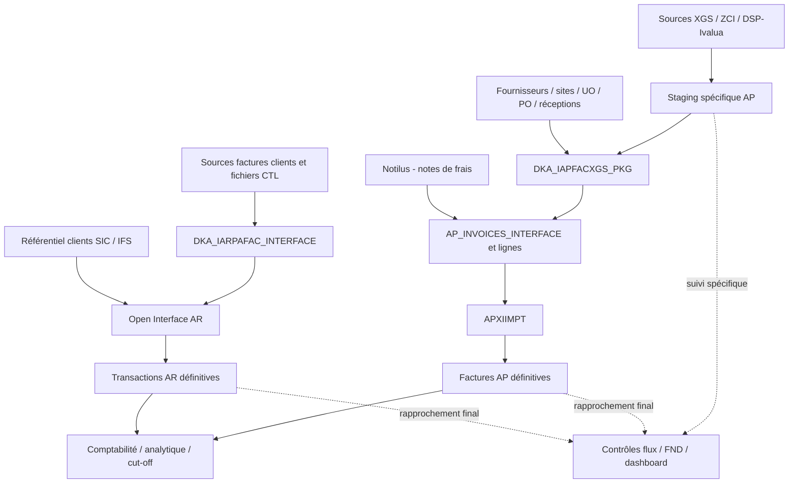

# Synthèse de l’intégration de la facturation

## Conclusion

Le dépôt décrit plusieurs chaînes de facturation Oracle EBS : factures fournisseurs AP, factures clients AR et notes de frais. Elles partagent les référentiels, la comptabilité et les outils de supervision. Il ne contient pas une seule application homogène : packages, diagnostics, variantes, archives et corrections ponctuelles doivent être distingués.

**Le point central du dossier est la preuve d’intégration.** Réception du fichier, dépôt dans une interface, statut du traitement spécifique, création de la facture définitive, comptabilisation et disponibilité de l’image sont des résultats différents. Les contrôles doivent préciser lequel ils mesurent. Dans le flux Xerox, le reporting peut être marqué OK avant le résultat d’APXIIMPT ; dans les contrôles AR, les volumes et montants n’ont pas toujours le même grain.

## Cartographie de lecture

Les flèches ci-dessous résument les étapes décrites dans les sources. Elles ne certifient ni un appel direct entre chaque objet, ni le paramétrage effectivement déployé.

Sources de cette cartographie : note AP, sections chaîne et interfaces ; note AR, tableau des étapes ; note comptabilité, sections chaîne comptable et cut-off. L’alimentation Notilus est documentée par les traitements communs et corrections de dates, sans reconstitution du producteur amont hors SQL/README.

## Résultats à retenir

| Domaine | Ce que les sources permettent d’établir | Conséquence pour l’analyse |
|---|---|---|
| Fournisseurs AP | Staging spécifique, rapprochement PO/réception, Open Interface et import standard ; version locale PROD identique à PKG.sql, ETI1 distincte | Distinguer version locale et version déployée ; ne pas attribuer les ajouts ETI1 à la production |
| Clients AR | Fichiers SRC/CTL, interface spécifique, interfaces et tables finales ; référentiel clients prérequis | Conserver origine, société, pièce, ligne, fichier et grain de montant dans les rapprochements |
| Avoirs | Règle finale annoncée et exemples du README KDFI-2198 contradictoires | Vérifier le signe réellement stocké et la branche traitée avant toute généralisation |
| Doublons | Plusieurs clés de détection et scripts de suppression avec effets persistants | Définir l’idempotence métier avant de choisir une suppression ou une relance |
| Comptabilité | Chaînes GL/XLA/réception/PO et variantes cut-off | Réconcilier clés et cardinalités ; éviter de sommer une provision répétée par facture |
| Supervision | Statuts FND, contrôles de flux, exports CSV et dashboard | Vérifier résultat, absence d’exécution et fraîcheur de l’extraction |
| Images et litiges | Liens, exports et blocages distincts de l’import comptable | Suivre séparément intégration facture, disponibilité image et résolution du litige |

## Anomalies concrètes et points d’attention

1. **SQL dashboard invalide** : virgule absente avant COUNT dans `Projet_Dashboard/sql/12_nuit_erreurs_programme.sql:5-6`.
2. **Compteur dématérialisation gonflé** : `THEN 2` pour NB_AUTRE dans `Projet_Dashboard/sql/19_demat_par_jour.sql:9`. Les statuts NULL ne sont pas non plus couverts par NOT IN.
3. **Fichier au format inattendu** : `ScriptsLanceurCentrale/D2_interface_statuts.sql:1` commence par un en-tête CSV ; le nom du fichier ne garantit pas son caractère exécutable SQL.
4. **Suppression AR à revoir** : sélection non agrégée d’IARPAFAC_ID absente du GROUP BY dans `Ligne_AR_En_Double/Sauvegarde_et_Suppression_Doublons_PRODUCTION.sql:272-275`.
5. **Rapprochement comptable à arbitrer** : clé de transaction RCV utilisée dans DTR-BO contre clé de sous-livre réception dans CAP V4 ; voir note comptabilité.
6. **Reprise à cadrer** : des scripts réinitialisent des marqueurs AP, AR et GL, puis committent ; leur portée dépasse un simple contrôle de flux.

Ces constats sont statiques ; les erreurs attendues et impacts opérationnels ne sont pas des résultats d’exécution obtenus pendant cette analyse. Les références et nuances détaillées figurent dans les notes spécialisées.

## Éléments disponibles et travail restant

L’inventaire et les notes fournissent les objets, règles, variantes, sources et risques utiles pour alimenter le dossier d’analyse. Le plan de validation transforme les incertitudes en cas de recette. Pour établir un dossier d’exploitation validé, il reste à rapprocher ces sources de la version compilée, du paramétrage, des contrats de fichiers et des résultats en recette.

Couverture : **193 fichiers, 159 SQL et 34 README**, environ **312 000 mots**. Inventaire complet et extraction mécanique ; profondeur de revue sémantique variable, explicitée dans les notes. Les grands packages ne sont pas certifiés instruction par instruction. Aucun SQL exécuté et aucune modification applicative.
